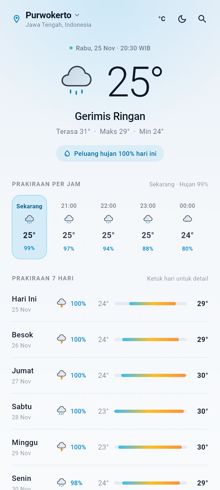
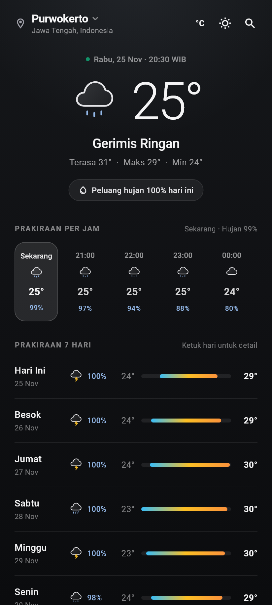
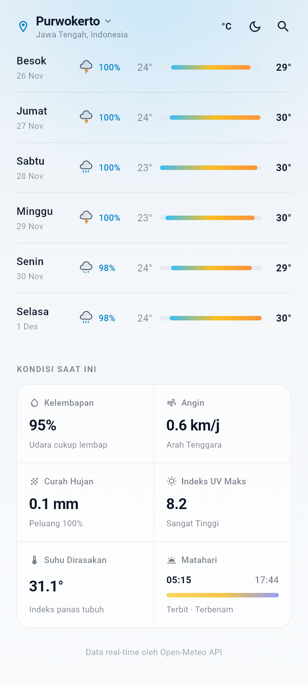
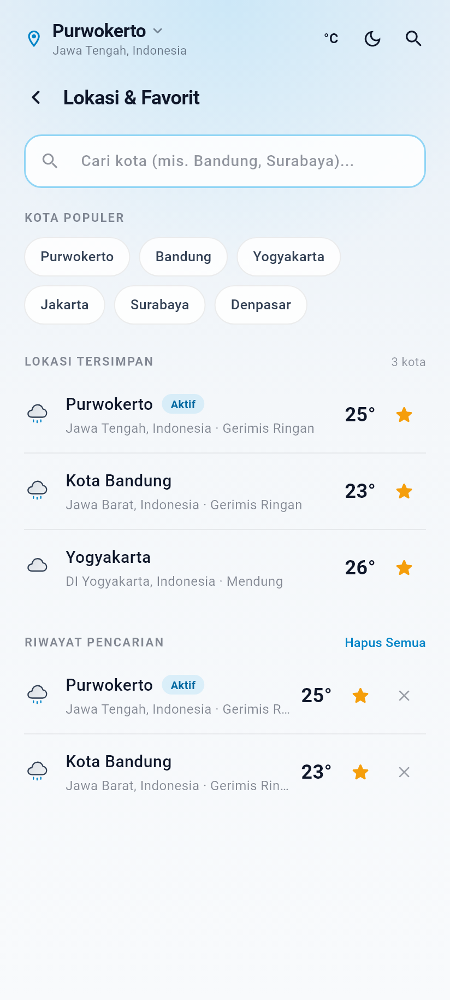
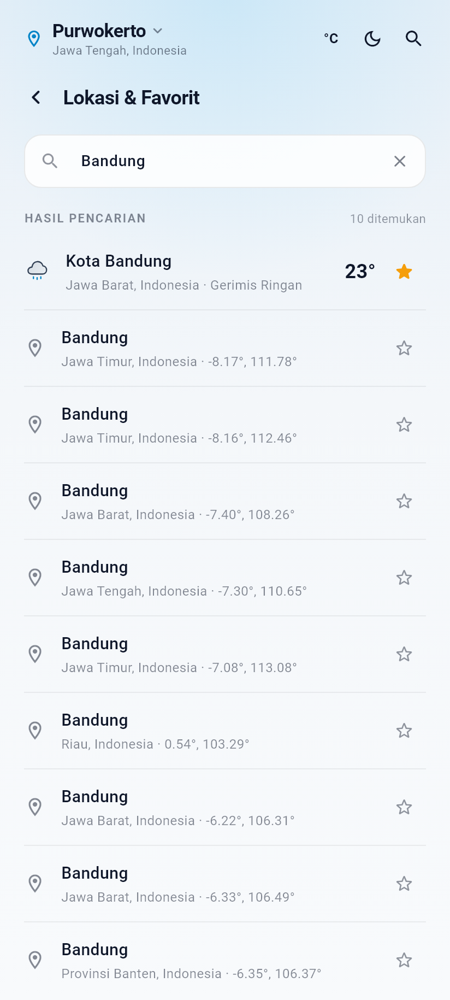
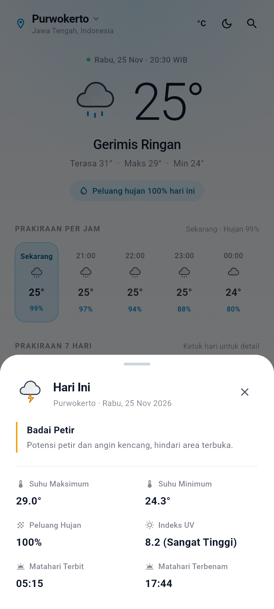

# SkyCast Cuaca — Aplikasi Prakiraan Cuaca Flutter (Open-Meteo & MVVM)

Aplikasi prakiraan cuaca berbasis **Flutter & Dart** yang mengambil data cuaca real-time dari **Open-Meteo Weather Forecast API** dan **Open-Meteo Geocoding API**, dibangun menggunakan pola arsitektur **Model-View-ViewModel (MVVM)** dengan **Provider** sebagai state management dan **SharedPreferences** sebagai penyimpanan lokal.

---

## Fitur Utama

- **Home / Weather Screen**
  - Menampilkan nama kota yang sedang dipilih, wilayah/negara, serta waktu lokal otomatis (`timezone=auto`).
  - Menampilkan kondisi cuaca terkini berbasis kode WMO (`current.weather_code`) lengkap dengan ikon dan gradien warna adaptif (siang/malam).
  - Menampilkan suhu saat ini (`current.temperature_2m`) dan suhu yang dirasakan (`current.apparent_temperature`).
  - Menampilkan detail tambahan secara responsif: kelembapan udara (`current.relative_humidity_2m`), kecepatan & arah angin (`current.wind_speed_10m`), curah hujan (`current.precipitation`), peluang hujan maksimum (`daily.precipitation_probability_max`), dan indeks UV / tekanan udara.
  - Menampilkan prakiraan cuaca **24 jam ke depan** (horizontal strip) dan **7 hari ke depan** (`daily.temperature_2m_max`, `daily.temperature_2m_min`, `daily.precipitation_probability_max`), dengan modal detail harian (matahari terbit/terbenam & indeks UV).
  - Fitur tambahan: **Pull-to-Refresh**, toggle satuan suhu **°C / °F**, toggle **Light / Dark Theme (Material 3)**, serta strip akses cepat kota favorit.
- **Search / Location Screen**
  - Input pencarian nama kota yang melakukan request HTTP `GET` secara real-time (dengan debounce & tombol cari) ke **Open-Meteo Geocoding API**.
  - Menampilkan daftar hasil pencarian lokasi lengkap dengan wilayah, negara, dan koordinat.
  - Memilih kota dari hasil pencarian untuk langsung menampilkan prakiraan cuacanya di Home Screen.
  - Menyimpan dan menghapus **Lokasi Favorit** serta mengelola **Riwayat Pencarian** secara persisten menggunakan **SharedPreferences** (tetap tersimpan saat aplikasi ditutup dan dibuka kembali).
- **Penanganan State Lengkap**
  - Menangani kondisi **Loading**, **Data Kosong**, dan **Error** (termasuk timeout / tanpa koneksi internet) lengkap dengan tombol **Coba Lagi**.

---

## Screenshot Aplikasi

|         Home / Weather Screen (Light)         |         Home / Weather Screen (Dark)         |               Prakiraan Per Jam & 7 Hari               |
| :--------------------------------------------: | :------------------------------------------: | :-----------------------------------------------------: |
|  |  |  |

|              Search, Favorit & Riwayat              |             Hasil Pencarian Geocoding API             |              Detail Prakiraan Harian              |
| :--------------------------------------------------: | :----------------------------------------------------: | :------------------------------------------------: |
|  |  |  |

---

## Struktur Aplikasi (MVVM)

```text
lib/
├── main.dart                           # Entry point, Dependency Injection (MultiProvider), MaterialApp & Theme
├── core/
│   ├── constants/
│   │   └── api_constants.dart          # Endpoint Open-Meteo, daftar parameter query, & lokasi awal
│   ├── theme/
│   │   └── app_theme.dart              # Material 3 ThemeData (Light & Dark) + Typography
│   └── utils/
│       ├── date_formatter.dart         # Pemformatan tanggal, hari, jam, suhu, & arah angin (ID)
│       └── weather_code_helper.dart    # Pemetaan WMO weather_code ke label, ikon, dan gradien warna
├── models/                             # [MODEL] Representasi data JSON API & Local Storage
│   ├── location_model.dart             # Model lokasi (Geocoding, Favorit, Riwayat)
│   └── weather_model.dart              # WeatherModel, CurrentWeatherModel, DailyForecastModel, HourlyForecastModel
├── services/                           # [DATA SOURCE] Networking & Local Storage
│   ├── weather_api_service.dart        # HTTP GET ke Open-Meteo Forecast & Geocoding API + error handling
│   └── local_storage_service.dart      # Persistensi SharedPreferences (favorit, riwayat, lokasi aktif, preferensi)
├── repositories/                       # [REPOSITORY] Abstraksi sumber data untuk ViewModel
│   └── weather_repository.dart         # Menghubungkan WeatherApiService & LocalStorageService
├── viewmodels/                         # [VIEWMODEL] Pengelolaan state & logika bisnis (ChangeNotifier)
│   ├── weather_viewmodel.dart          # State cuaca aktif, lokasi dipilih, favorit, riwayat, unit suhu, & tema
│   └── search_viewmodel.dart           # State input pencarian, debounce, hasil Geocoding API, & status error/empty
└── views/                              # [VIEW] Antarmuka Flutter (StatefulWidget & StatelessWidget)
    ├── screens/
    │   ├── weather_screen.dart         # Screen 1: Home / Weather Screen (StatefulWidget)
    │   └── search_screen.dart          # Screen 2: Search / Location Screen (StatefulWidget)
    └── widgets/
        ├── atmospheric_background.dart # Latar gradien atmosfer adaptif (rain/clear/cloudy, light/dark)
        ├── weather_outline_icon.dart   # CustomPainter ikon cuaca garis halus (minimalist vector)
        ├── sky_top_header.dart         # Header navigasi tunggal (kota, °C/°F, tema, cari)
        ├── weather_hero_card.dart      # Hero cuaca atmosferik & pill konteks peluang hujan
        ├── hourly_forecast_strip.dart  # Strip interaktif prakiraan per jam (24 jam)
        ├── daily_forecast_list.dart    # Daftar lapang prakiraan 7 hari dengan pembatas hairline
        ├── weather_metrics_grid.dart   # Grid 2 kolom hairline kondisi saat ini + bar matahari
        ├── daily_detail_sheet.dart     # Bottom sheet editorial rincian prakiraan harian
        └── state_views.dart            # Reusable widget Loading, Error, & Empty State
```

---

## Penerapan Arsitektur MVVM

Aplikasi menerapkan pola **Model-View-ViewModel (MVVM)** untuk memisahkan tanggung jawab antara tampilan UI, pengelolaan state, dan sumber data:

1. **Model (`lib/models/`)**
   - `LocationModel` dan `WeatherModel` (`CurrentWeatherModel`, `DailyForecastModel`, `HourlyForecastModel`) merepresentasikan struktur data dari respons JSON Open-Meteo API sekaligus serialisasi JSON untuk penyimpanan lokal.
2. **Service & Repository (`lib/services/`, `lib/repositories/`)**
   - `WeatherApiService` melakukan permintaan HTTP `GET` menggunakan package `http` serta menerjemahkan error jaringan/HTTP menjadi `ApiException`.
   - `LocalStorageService` menyimpan dan memuat daftar lokasi favorit, riwayat pencarian, lokasi terakhir yang dipilih, satuan suhu, dan tema via `shared_preferences`.
   - `WeatherRepository` mengoordinasikan kedua service tersebut agar ViewModel tidak bergantung langsung pada detail implementasi HTTP atau storage.
3. **ViewModel (`lib/viewmodels/`)**
   - `WeatherViewModel` dan `SearchViewModel` mewarisi `ChangeNotifier` (di-inject melalui `MultiProvider` pada `main.dart`).
   - ViewModel menyimpan state UI (`WeatherUiStatus`, `SearchUiStatus`), memproses permintaan data asinkron, dan memanggil `notifyListeners()` agar View melakukan rebuild secara reaktif.
4. **View (`lib/views/`)**
   - `WeatherScreen` dan `SearchScreen` (keduanya `StatefulWidget`) serta komponen widget modular (`StatelessWidget`) hanya bertugas merender UI berdasarkan state dari ViewModel (`context.watch` / `context.read`) dan meneruskan aksi pengguna ke ViewModel.

```text
User Action ──► View (Screens & Widgets)
                   │  context.read / context.watch (Provider)
                   ▼
             ViewModel (WeatherViewModel / SearchViewModel)
                   │
                   ▼
             Repository (WeatherRepository)
               ┌───┴──────────────────────┐
               ▼                          ▼
     WeatherApiService           LocalStorageService
  (Open-Meteo HTTP GET)          (SharedPreferences)
```

---

## Implementasi Open-Meteo API

Seluruh data cuaca dan hasil pencarian kota diperoleh langsung dari REST API **Open-Meteo** menggunakan metode HTTP `GET` tanpa API key dan tanpa data statis/hardcoded.

### 1. Weather Forecast API

- **Endpoint**: `GET https://api.open-meteo.com/v1/forecast`
- **Parameter Utama**:
  - `latitude` & `longitude`: koordinat kota yang dipilih.
  - `timezone=auto`: menyesuaikan zona waktu otomatis sesuai lokasi.
  - `forecast_days=7`: mengambil prakiraan 7 hari ke depan.
  - `current`: `temperature_2m,relative_humidity_2m,apparent_temperature,is_day,precipitation,weather_code,wind_speed_10m,wind_direction_10m,surface_pressure`
  - `daily`: `weather_code,temperature_2m_max,temperature_2m_min,precipitation_probability_max,sunrise,sunset,uv_index_max`
  - `hourly`: `temperature_2m,weather_code,precipitation_probability,is_day`

| Data Ditampilkan       | Field Open-Meteo API                    |
| :--------------------- | :-------------------------------------- |
| Suhu saat ini          | `current.temperature_2m`              |
| Kelembapan udara       | `current.relative_humidity_2m`        |
| Suhu yang dirasakan    | `current.apparent_temperature`        |
| Curah hujan            | `current.precipitation`               |
| Kode kondisi cuaca     | `current.weather_code`                |
| Kecepatan angin        | `current.wind_speed_10m`              |
| Suhu maksimum harian   | `daily.temperature_2m_max`            |
| Suhu minimum harian    | `daily.temperature_2m_min`            |
| Peluang hujan maksimum | `daily.precipitation_probability_max` |

### 2. Geocoding API

- **Endpoint**: `GET https://geocoding-api.open-meteo.com/v1/search`
- **Parameter**: `name=<nama_kota>&count=15&language=id&format=json`
- Digunakan pada **Search / Location Screen** untuk mencari koordinat dan metadata lokasi berdasarkan kata kunci pengguna.

---

## Cara Menjalankan Proyek

1. Pastikan Flutter SDK telah terpasang (`flutter --version`).
2. Unduh dependensi:
   ```bash
   flutter pub get
   ```
3. Jalankan aplikasi pada emulator Android, perangkat fisik, atau Chrome:
   ```bash
   flutter run
   ```
4. Jalankan analisis statis dan unit/widget test:
   ```bash
   flutter analyze
   flutter test
   ```

---

## Dependensi Utama

- [`http`](https://pub.dev/packages/http) — HTTP client untuk permintaan `GET` ke Open-Meteo REST API.
- [`provider`](https://pub.dev/packages/provider) — State management berbasis `ChangeNotifier` untuk arsitektur MVVM.
- [`shared_preferences`](https://pub.dev/packages/shared_preferences) — Penyimpanan lokal persisten untuk lokasi favorit, riwayat pencarian, lokasi terakhir, dan preferensi tema/satuan.
